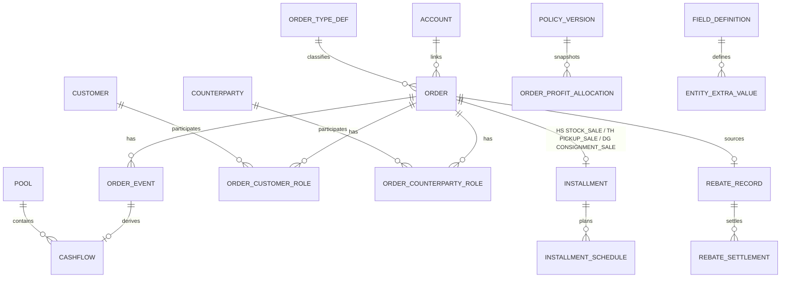

# 宜游轩 ERP · 架构设计 v1.0

> **权威来源**：[PRD v1.2](ERP_PRD_v1.2_当前实现版.md) → [ERP_PRD_F01_功能规格说明书](ERP_PRD_F01_功能规格说明书.md)。本文负责落实架构，不得改变前两者。前端目录和 UI 设计系统以 `/Users/aries/Developer/business-line-erp/frontend` 为参考源。

## 设计边界

| 来源 | 架构处理方式 |
|---|---|
| PRD、功能规格 | 定义新业务领域、资金口径、状态机、字段与 P0 范围；架构必须严格实现。 |
| 数据字典、DDL、API | 作为本架构的具体契约；出现命名冲突时统一修订到 PRD/功能规格口径。 |
| 历史数据、迁移报告、旧库 | 仅进入 `migration` 参考域；不参与新单建模、路由、状态流转或上线阻断。 |

> 系统可在没有任何历史记录时正常上线。导入是 P2 能力；无法可靠关联的旧记录保留异常标识，不通过猜测修改新领域模型。

## 架构原则

- `order_events` 是业务事实；有资金影响的事件在同一事务派生唯一 `cashflow`，以 `order_event_id` 关联，禁止双录。
- `pools` 是资金池主数据，余额由流水聚合；池、业务及两者路由均可配置。
- 历史不猜测：无法可靠关联的记录标 `UNLINKED`、`ORPHAN` 或 `UNLINKED_TRANSFER`。
- 固定核算字段保证审计；活字段只扩展业务描述，不得改变金额、池、事件、关联或核算。
- 物理表名唯一：`cashflow`、`installments`、`installment_schedules`、`rebate_records`、`rebate_settlements`；禁止另造 `installment_contracts`、`rebate_accruals` 等同义模型。REST 资源路径可使用复数形式（如 `/cashflows`），但底层实体仍为 `cashflow`。

## 分层

```
React 18 + Vite + Ant Design 5
  资金池总览 / 订单事件 / 库存 / 分期 / 返点 / 报表 / 异常 / 字段配置
FastAPI
  Router → EventService / LedgerService / ReportService / FieldService
SQLAlchemy 2.0
  SQLite（MVP）→ PostgreSQL（演进）
```

## 前端复用规范

已复制参考工程的设计令牌与基础样式到 `frontend/src/`：

```
frontend/src/
├── shared/styles/        # tokens、typography、a11y、hierarchy、page-layouts、navigation
├── shared/ui/            # antd-adapter.css
├── system-shell.css      # 工作台外壳样式
├── app/                  # AppShell、导航、路由守卫（按参考工程组织）
├── pools/ stocks/ orders/ installments/ rebates/ quality/ reporting/
│   ├── pages/            # 各领域页面
│   ├── components/       # 领域组件
│   └── index.ts          # 领域出口
└── shared/api/ shared/state/ shared/format.ts
```

新页面必须引用 `tokens.css`、`typography.css`、`a11y.css`、`antd-adapter.css`，复用参考工程的 AppShell、页面层级、卡片、表格、筛选条和导航交互；不得复制参考工程的订单、财务、薪资等业务域代码或其接口契约。

## 后端复用规范

后端目录 `backend/app` 的**实际结构**（2026-11-01 实测）：

- 基础设施：`core/`（settings / database / money / errors / security / audit / numbering / state_machine）、`domain/`（全部 ORM 与枚举）
- 领域包：`foundation`、`parties`、`orders`（含 `form_fields_router`）、`stocks`、`value_added_services`、`finance`、`reporting`、`policy`、`quality`、`notifications`、`imports`、`audit`、`auth`（含 `admin_router` / `teams_router`）、`attachments`、`options`、`lists`、`search`
- 两个易误记的命名：**分期域包名是 `value_added_services`**，路由前缀仍为 `/installments`，不存在 `app/installments/`；**人员与团队没有独立包**，路由挂在 `auth` 包内
- 测试在 `backend/tests/v1`（单一目录，不存在 `tests/api|domain|services` 分层）；迁移在 `backend/alembic/versions`
- 早期过渡实现 `models_new` / `services_new` 已全部迁入领域包并删除；不复制参考工程的业务模型、权限、多组织或外部集成代码

## 核心关系



| 领域 | 核心表 | 规则 |
|---|---|---|
| 资金 | pools / cashflow / deposits | OWNED/CUSTODY/THIRD_PART；押金不计损益；新 INTERNAL 成对 |
| 订单 | order_type_defs / orders / order_events | HS/TH/DG 为首批业务；订单汇总由事件派生 |
| 账号 | stocks | HS/TH/DG 均关联库存账号；`stock_no` 为 KU_ 五位编号；`game_account` 不唯一（可反复收购）；`status` 与 `inventory_status` 两条轴；BUY+COST 按业务规则累加成本 |
| 客户 | customers / order_customer_roles | 微信号、QQ、手机号、备注等复购资料；客户可跨订单多角色；联系方式非唯一 |
| 合作方 | counterparties / order_counterparty_roles | 同行、供货方、平台；与客户分离，按业务角色关联 |
| 分期 | installments / installment_schedules | `installments` 三类合约 STOCK_SALE(HS) / PICKUP_SALE(TH) / CONSIGNMENT_SALE(DG)；一单一合约，均从所属订单取库存信息、不单独存 account_id；`installment_schedules` 为期次明细；PAYMENT→换绑→DELIVER |
| 返点 | rebate_records / rebate_settlements | HS0001-RB01 返点记录，HS0001-RB01-CF-01 分次到账 |
| 经营规则 | policy_definitions / policy_versions / order_profit_allocations | 费率、提成、分期、跌价等版本化；已发生业务保存快照 |
| 活字段 | field_definitions / entity_extra_values | 可增、停用、排序；历史值不可删除 |

## 核算服务

| 服务 | 职责 |
|---|---|
| EventService | BUY/COST/SELL/PAYMENT/DELIVER/CANCEL、池路由、编号和现金流派生；DELIVER 不派生现金流 |
| LedgerService | 池余额、库存、经营损益、权益、划转对称性 |
| TransferService | 新跨池划转一次生成两条流水和同一 transfer_id |
| InstallmentService | 三类分期合约、应收/已收/剩余、逾期与违约、回收/转售处置；结清后生成无现金流 DELIVER 释放库存 |
| RebateService | 返点记录、手续费、分次到账和来源订单 |
| QualityService | 未关联、单边划转、库存缺账号、呆滞、断分期异常 |
| PolicyService（P1） | 经营规则版本、生效区间、快照、多人利润分配与手工覆盖审计 |
| ImportService（P2） | 源文件只读导入、异常保留、人工补录与对账；不参与新业务流程 |

## 页面与接口

资金池总览须展示余额、收入、支出、押金占用和可动用余额。订单中心展示业务编号和事件时间线；库存只统计已关联的在库/分期中账号；返点、分期、异常工作台和字段配置均为独立页面。

## 约束

- 金额 `DECIMAL(18,2)`，禁止 float；所有金额写操作走 Service 事务。
- 新 INTERNAL 不影响合并现金/损益但改变单池余额；历史单边划转不可自动补账。
- SQLite 开启外键；旧库只读保留；新 ERP 使用独立数据库和可重复的 P2 迁移脚本。
