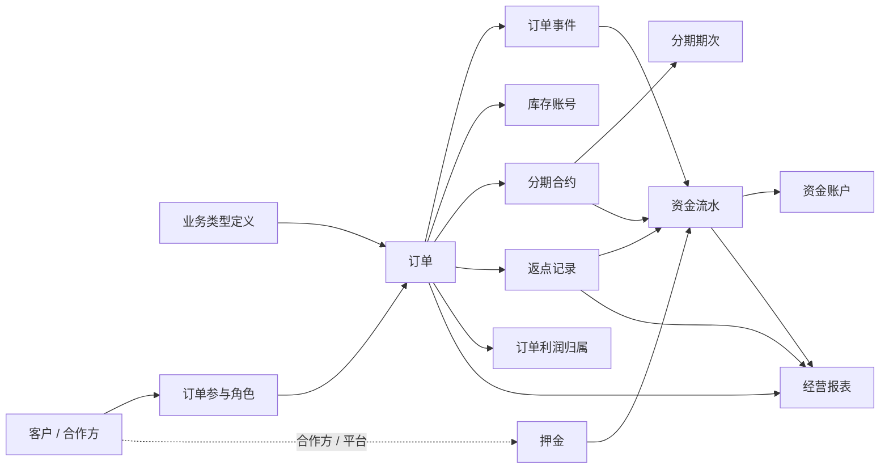

# 宜游轩 ERP · 业务架构 v1.9

| 项    | 内容                                  |
| ---- | ----------------------------------- |
| 文件编号 | 业务架构_v1.9                           |
| 运行域  | 工作经营 / 黑金时代 ERP                     |
| 阅读对象 | 产品、前后端开发、数据治理、测试与交付                 |
| 编写日期 | 2026-11-19                          |
| 编写人  | WorkBuddy（依当前 ORM、枚举、接口域与现行事实源实测整理） |

**版本记录**

| 版本   | 日期         | 终态口径变更                                                                                  |
| ---- | ---------- | --------------------------------------------------------------------------------------- |
| v1.9 | 2026-11-19 | 后端域名全面对齐前端导航 key（用户裁决）：`workbench`→`dashboard`、`customer_center`→`customers`、`finance`→`funds`、`reporting`→`operations`（`business`/`settings` 已对齐）。后端 6 域与前端 6 导航 key 一一同名；前端目录/导航/深链 key 不动。API URL 不变。§3 同步。 |
| v1.8 | 2026-11-19 | 域名对齐（用户裁决）：订单域改称业务域，与前端导航「业务中心」一致。后端 `app/orders/` → `app/business/`（含 stocks 子模块）、前端 `src/orders/` → `src/business/`；importlinter 契约 `orders↛finance` → `business↛finance`。API URL 不变（前端导航 key 本就是 `business`）。§3 同步。 |
| v1.7 | 2026-11-19 | 平台能力并入设置域（用户裁决）：`auth` / `audit` / `attachments` 并入 `app/settings/`（三子包），与 `field_definitions` / `options` / `lists` 汇成设置域六子模块。起因：audit/attachments 依赖 `auth/session.py`，三者同属平台能力簇，只搬 auth 会造成外部域跨域引用 settings 内认证，故整簇并入。前端登录 / 个人中心不在设置页，不动。API URL 不变。§3 同步。 |
| v1.6 | 2026-11-19 | 通知并入工作台域（用户裁决）：`notifications` 合并为 `app/workbench/notifications/`，使后端目录与「通知属工作台」的归属对应；前端无独立通知目录（业务提醒在 `app/` 与 `shared/api/`），不动。auth/audit/attachments 仍属平台能力。API URL 不变。§3 同步。 |
| v1.5 | 2026-11-19 | 设置域三合一（用户裁决）：`field_definitions` / `options` / `lists` 合并为 `app/settings/`（三子包），使后端目录与业务架构「设置」域一一对应；前端 `src/field-definitions/` → `src/settings/` 镜像。auth/audit 属平台能力不并入。API URL 不变。§3 同步。 |
| v1.4 | 2026-11-19 | 域边界调整（用户裁决）：库存（`stocks`）从独立域并入订单域，代码目录迁至 `app/orders/stocks/`，成为 orders 子模块；库存账号本由订单事件产生、无独立生命周期。前端镜像：`src/stocks/`→`src/orders/stocks/`、`src/installments/`→`src/finance/installments/`（补 v1.3 合并 finance 时前端未动的归属）。collaboration 注册点保留（合并后仍工作）；importlinter 删 `stocks↛orders` 契约（4→3）。API URL 不变。§3 同步。 |
| v1.3 | 2026-11-19 | 域边界调整（用户裁决，推翻 v1.1 四域中的归属）：分期（`installments`）与利润分配（`profit_allocation`）从订单域并入资金域，代码目录迁至 `app/finance/` 下，成为 finance 子模块；资金中心业务职责扩展为流水、余额、划转、押金、返点、对账、分期与利润分配。API URL 与路由挂载不变，importlinter 契约由 `orders↛installments` 改为 `orders↛finance` 统一约束。§3 同步。 |
| v1.2 | 2026-11-19 | 押金分两类并各自归账簿：业务押金（`BUSINESS`，入驻平台 / 房租等保证金，挂合作方）与工作室运营押金（`STUDIO`，不挂订单），`deposits.ledger_type` 区分；占用/释放/损失/取消派生流水同账簿；两类都不进损益，STUDIO 押金不进工作室收支面板。§5.6 / §6 同步。 |
| v1.1 | 2026-11-19 | 押金口径纠正：押金主要对应入驻平台 / 房租等保证金，登记在合作方上、`source_order_id` 可选，不必然由订单产生；§1 / §4 对象关系图 / §5.6 同步修正。v1.0 首版：32 张 ORM 业务表、35 个业务枚举类；不收录已下线的导入子系统、经营规则域、订单关联、资金性质、账户归属与返点状态。 |

> **文档边界**：本文定义业务结构、域边界、协作关系与不可协商的业务口径；字段级事实见[数据字典](数据字典.md)，接口路径 / 状态机 / 权限见[接口与权限契约](接口与权限契约.md)，页面与功能范围见[PRD](PRD.md)。文档与代码冲突时以代码为准，并回改文档。

---

## 1. 业务定位

宜游轩 ERP 是**工作室账号交易的经营系统**：以订单为主线，把账号买卖、分期收款、客户与合作方、资金流水、返点、利润分配和经营报表串成一条可审计的业务链；押金独立登记，主要对应入驻平台 / 房租这类保证金，不必然由订单产生。系统不管理仓储物流，不生成财务凭证，不提供账期锁定与规则引擎。

业务上的三个基本判断：

1. **订单是交易主线，押金除外**。资金、库存、分期、返点、分润都通过订单或订单事件回溯；押金对应平台入驻 / 房租等保证金，可独立登记，不强制挂订单。
2. **资金流水登记即生效**。没有草稿态与二次审核；错误用反向冲销修正，原事实保留。
3. **口径收敛到唯一权威**。利润、分期按钮、返点金额各有唯一计算来源，前端不自行判定。

## 2. 业务分类模型

产品分类分三层，不可混称：

| 层级    | 取值                                                     | 业务含义               |
| ----- | ------------------------------------------------------ | ------------------ |
| 经营模式  | `SELF` / `DISTRIBUTION`                                | 自营与分销，决定账号与资金归属    |
| 主业务类型 | `HS` 回收 / `TH` 提号 / `DG` 代挂                            | 账号来源与核心交易，三者同级     |
| 增值服务  | `STOCK_SALE` / `PICKUP_SALE` / `CONSIGNMENT_SALE` 分期合约 | 依附于既有售出动作，不新建主业务订单 |

归属关系固定：`SELF` 只承载回收及由回收库存发起的分期出售；`DISTRIBUTION` 承载提号与代挂；`STOCK_SALE` / `PICKUP_SALE` 分别从 HS / TH 售出发起，`CONSIGNMENT_SALE` 仅保留历史读取，不允许新建；代挂售出只支持全款。错误组合由后端拒绝。

`order_type_defs.is_zero_principal` 是业务定义层的本金约束（当前仅 DG 为 `true`），禁止该类型登记 `PRINCIPAL` 本金支出；它不是订单字段，不支持按单覆盖。

## 3. 业务域地图

后端按四层组织，依赖只允许自顶向下：`core`（纯技术底座，零 ORM）→ `domain`（ORM / 枚举 / 纯领域知识）→ `shared`（跨域共享原语，不归属任何业务域）→ 业务域。业务域之间允许单向依赖，禁止成环；`importlinter` 3 条契约在 CI 强制。

| 业务域  | 业务职责                        | 后端模块                                               | 主要对象             |
| ---- | --------------------------- | -------------------------------------------------- | ---------------- |
| 工作台  | 三类建单入口、经营摘要与待办、通知         | `workbench`（含 `overview` / `notifications` 子模块） | 只读聚合、通知          |
| 业务中心 | 建单、业务事件、订单详情、导出、表单字段、账号库存、分期与回款 | `business`（含 `orders` / `inventory` / `installments` 子模块，内部共享订单详情、操作和表单配置） | 订单、事件、参与角色、库存账号、合约、期次 |
| 客户中心 | 客户、需求、合作方与参与关系维护 / 合并       | `customers`                                        | 客户、客户需求、合作方      |
| 资金中心 | 流水、资金余额、划转、押金、返点、对账、利润分配 | `funds`（含子模块 `profit_allocation`） | 流水、押金、返点记录、对账、订单利润分配 |
| 经营中心 | 月度损益、业务损益、订单利润、分润对账、数据中心与导出 | `operations`                                       | 只读聚合 / CSV       |
| 设置   | 资金账户、业务类型、活字段、选项词典、列表列配置、登录授权、组织人员、审计、附件 | `settings`（含 `field_definitions` / `options` / `lists` / `auth` / `audit` / `attachments` 六子模块） | 主数据与配置、用户、团队、审计日志 |

前端导航为工作台 / 业务中心 / 客户中心 / 资金中心 / 经营中心 / 设置，分别对应后端 `workbench` / `business` / `customers` / `funds` / `operations` / `settings` 域；工作台导航 key 为 `workbench`。工作台前端模块为 `src/app/workbench/quick-access/`、`overview/`、`notifications/`，后端模块为 `app/workbench/overview/`、`notifications/`，提醒配置由 `app/workbench/reminder_config.py` 共享。**注意语义区分：前端 `pools/` 是资金中心页面代码目录，对应后端 `funds` 域；后端 `settings/field_definitions/pools.py` 是资金池主数据，属设置**——二者语义不同。

## 4. 核心对象关系

关键约束：

- 订单不保存金额汇总；`total` 是成交总额（gross），**不等于本金 + 利润**。
- 事件是资金的业务来源，以 `source_type` / `source_id` 回溯；返点关联用业务编号 `rebate_no`（如 `HS0001-RB01`），不用数据库自增主键。
- 有历史流水的对象只能停用或冲销，不能物理删除。

## 5. 关键业务链路

### 5.1 订单主链

建单（绑定客户 / 合作方角色）→ 登记业务事件（`BUY` / `SELL` / `DELIVER` / `CANCEL` / `OPERATE` / `REBATE`）→ 金额事件原子生成资金流水 → 可挂分期合约 → 完成 / 取消 → 进入报表与分润对账。取消与冲销以原池、原日期生成反向流水，不删除原事件。

分润归属按动作确定：`BUY` / `SELL` 强制绑对应事件执行人，`OPERATION` 强制绑人，`COMPANY` 禁止绑人；自动候选一律以表单 `form_extra` 优先、事件执行人次之。

### 5.2 回收（HS）

自营买入账号形成 `RECOVERY` 库存（`WAITING` 在库）；售出后库存转 `SOLD`。回收分期出售从既有 HS 售出发起 `STOCK_SALE` 合约，不新建订单。

### 5.3 提号（TH）

按客户需求向同行采购（`OUT` 买入支出），再售予客户（`TH_REVENUE` 收入）。提号实体不计入自营库存资产；可发起 `PICKUP_SALE` 分期。

### 5.4 代挂（DG）

受托销售账号，只记录售出金额、利润、寄售方与平台。DG 不配置抽成比例、金额来源与自动结算公式，禁止登记本金支出；**DG 同样可以有售出返点**（买号返点才限 HS / TH）。DG 收支仅含 `DG_REVENUE` 与其他收支。

### 5.5 分期

合约创建 → 期次计划（`due_amount` = 本金 + 服务费）→ 收款（`IN`）→ 结清 → `DELIVER`（无金额，不确认收入）→ 交付。`available_actions` 由后端纯函数计算并下发，前端只回显；期次减免不改写原应收，展期只改到期日。

### 5.6 押金、返点与划转

- 押金分两类，由 `deposits.ledger_type` 区分：业务押金（`BUSINESS`）主要对应入驻平台 / 房租等保证金，登记在合作方（`counterparty_id`）上、`source_order_id` 可选；工作室运营押金（`STUDIO`）不挂订单、禁填 `source_order_id`。两类均为占用（`OUT`）→ 部分 / 全部释放（`IN`）→ 损失核销，四条派生流水归押金同账簿，都不进损益、不二次扣减可用余额；STUDIO 押金不进工作室收支面板，工作室侧日常运营收支仍走「工作室支出」页。
- 返点：登记即确认收入，金额唯一取 `rebate_records.amount`（由登记人明确填写，不按成交额 / 本金 / 利润反推）；无状态、无作废 / 删除，退回走真实 `OUT` 流水。
- 划转：同一 `transfer_id` 原子生成一出一入两笔流水，无草稿与二次审核；单边记录只能走异常修复。

## 6. 资金与利润口径（不可协商）

| 主题   | 口径                                                                                                                        |
| ---- | ------------------------------------------------------------------------------------------------------------------------- |
| 利润   | **单订单全部收入 − 全部支出**，可正 / 负 / 0；唯一权威为共享原语 `order_cashflow_profit`                                                           |
| 收入   | 流水 `IN` + 返点；返点是收入的「其中项」，禁止再加一次                                                                                           |
| 支出   | 流水 `OUT` + 分期坏账                                                                                                           |
| 账簿   | `BUSINESS` 业务资金 / `STUDIO` 工作室运营；方向 `IN` / `OUT`；核算属性 15 值（含回收 / 提号各自的成本与收入、代挂收入、服务费收入、返点收入、其他收支、运营支出、押金、外部资金、内部划转、冲销、退款） |
| 余额   | `income − expense == cash_balance − opening`；`available = cash_balance`（押金占用已进入支出，不再扣减）                                   |
| 押金净额 | 收入 − 支出 + 利润 − 损失；损失是「−利润」，不是第二笔现金流出                                                                                      |
| 分润   | 公司比例可配置，默认盈利 40% / 亏损 50%；分润只保存利润归属，不生成资金流水                                                                                   |

服务费的会计属性 `SERVICE_REVENUE` 为预留值；分期服务费省略时按「不收（0）」处理，不按规则费率补算。

## 7. 状态机总览

| 对象   | 状态与要点                                                                                                                                                           |
| ---- | --------------------------------------------------------------------------------------------------------------------------------------------------------------- |
| 订单   | `ACTIVE` → `INSTALLMENT` / `COMPLETED` / `CANCELLED`；创建即 `ACTIVE`，无草稿；`CANCELLED` 为终态                                                                           |
| 库存账号 | 生命周期 `WAITING` / `SOLD` / `VOID` 与在场状态 `IN_STOCK` / `OUT_OF_STOCK` 是**两条独立轴**；同一游戏账号可反复买入，每次为独立实体                                                               |
| 分期合约 | `PENDING` / `ACTIVE` / `OVERDUE` / `SETTLED` / `DELIVERED` / `DEFAULTED` / `CLOSED` / `CANCELLED` 八态；期次另分 `PENDING` / `PARTIAL` / `PAID` / `OVERDUE` / `WAIVED` |
| 资金流水 | 无状态机；登记即生效                                                                                                                                                      |
| 返点记录 | 无状态机；登记即确认收入，无独立作废 / 结算状态                                                                                                                                       |
| 客户   | `ACTIVE` / `DISABLED` / `MERGED`；停用不参与新单，合并须指定 `ACTIVE` 目标                                                                                                      |
| 合作方  | `ACTIVE` / `DISABLED`；停用不参与新单                                                                                                                                   |
| 押金   | `PAID` / `PARTIALLY_RETURNED` / `RETURNED` / `LOST` / `CANCELLED`；释放金额不得超过占用金额                                                                                  |

## 8. 工程约束（业务视角）

1. **金额**：一律 `Amount` / `DECIMAL(18,2)`，禁止 float 参与计算。
2. **写路径**：走 Service 事务并写审计，路由层不直接改模型；权限不足返回 `403`，越权对象返回 `404` 不泄露存在性。
3. **权限**：角色决定能否执行，数据范围（`owner_scope` + `pool_ids` + `team_ids`）决定可见对象；权限点闭集以代码为准（实测 23 项）、5 类角色，详见接口契约。
4. **迁移**：活动链只有基线 `0001`（`create_all` + 种子）；改 ORM 即改基线，结构落后的库不得 `stamp`，上线走原地增量。
5. **无兼容层**：能力下线时旧路径、旧字段、旧枚举零残留；能下线必须留下线记录（见下节），不靠别名过渡。

## 9. 已下线能力（勿按旧资料开发）

| 已下线                                                       | 现行替代 / 说明                                                    |
| --------------------------------------------------------- | ------------------------------------------------------------ |
| 导入子系统（`import_batches` / `import_rows`、`IMP` 编号域）         | 整域移除，无导入入口                                                   |
| 经营规则域（规则定义 / 版本 / 快照）                                     | 分润模块独立；公司比例可配置，默认盈利 40% / 亏损 50%                                      |
| 订单关联（`order_links` 及 `link_status`）                       | 返点用 `rebate_no` + `source_id` 显式关联                           |
| 资金性质 `Nature` / 账户归属 `PoolOwnership`                      | 方向用 `direction`，划转用 `source_type=TRANSFER`；账户类型用 `pool_type` |
| 返点状态 `RebateStatus`                                       | 无状态；退回走真实 `OUT` 流水                                           |
| 资金账户路由、账期锁定、`DFQ` 代分期                                     | 未指定账户统一进入默认池；分期只挂既有订单                                        |
| 旧枚举 `DeliveryMode` / `CommissionMode` / `CommissionPayer` | 交付方向由 `form_extra.delivery_direction` 承担；抽成概念不再配置            |

## 10. 文档谱系

- [PRD](PRD.md)：产品边界、页面与验收；**注意 PRD 部分章节仍保留清理前的旧口径，业务结构以本文与数据字典为准**。
- [数据字典](数据字典.md)：字段级唯一事实源（表 / 字段 / 枚举 / 编号规则 / 口径裁决）。
- [接口与权限契约](接口与权限契约.md)：API、状态机、错误码、权限矩阵与数据范围。
- [研发流程](研发流程.md)：开发、测试与本地验收；[发布流程](发布流程.md)：生产发布与阿里云部署。
