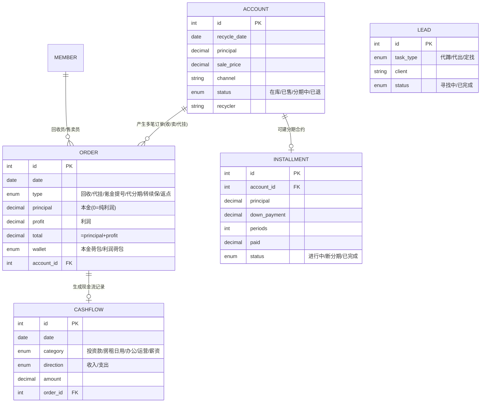

# 黑金时代工作室 · 简易 ERP 架构设计

> 版本：v1.0 ｜ 关联文档：黑金时代简易ERP_PRD.md ｜ 原则：第一性原理 + 多快好省
> 范围：MVP（M1 记账 / M2 库存 / M3 订单 / M6 报表），P1（M4 分期 / M5 需求）预留接口

---

## 1. 架构总览（分层）

```
┌─────────────────────────────────────────────┐
│  表现层  Browser (Responsive, Tablet 优先)      │
│  React 18 + Vite + Ant Design 5              │
│  Pages: 仪表盘/记账/库存/订单/报表/(分期/需求) │
└───────────────┬─────────────────────────────┘
                │  HTTPS / JSON  (Axios)
┌───────────────▼─────────────────────────────┐
│  应用层  FastAPI  (REST API)                  │
│  Routers(薄) → Services(厚,含核算逻辑)         │
│  · OrderService  本金/利润拆分+库存联动        │
│  · ProfitService 双荷包聚合(本金/利润隔离)     │
│  · ReportService 利润表/库存表/业绩            │
└───────────────┬─────────────────────────────┘
                │  SQLAlchemy 2.0
┌───────────────▼─────────────────────────────┐
│  数据层  SQLite (MVP) → PostgreSQL (演进)      │
│  Tables: accounts/orders/cashflow/            │
│          installments/leads/members           │
│  · 双荷包 = 视图(由 orders 聚合,非实体表)     │
└─────────────────────────────────────────────┘
```

**设计铁律**：本金流水与利润流水在 Order 模型层就强制分离（双字段），聚合层绝不交叉。荷包余额是计算视图，不是可写的实体。

---

## 2. 技术选型

| 层 | 选型 | 理由（多快好省） |
|----|------|------------------|
| 前端 | React 18 + Vite 6 + TypeScript + Ant Design 5 | 与现有 business-line-erp 同源，组件复用，Table/Form 开箱即用 |
| 状态 | Zustand 或 React Query | 轻量；Query 处理服务端状态，避免 Redux 冗余 |
| 后端 | FastAPI + Pydantic v2 | 类型即文档，校验强，_async 高并发够用 |
| ORM | SQLAlchemy 2.0 (declarative) | PRD 已定义表结构，2.0 风格清晰 |
| 数据库 | SQLite (MVP) → PostgreSQL (P1+) | 百级数据量 SQLite 零运维；量大一键迁 PG，SQLAlchemy 屏蔽差异 |
| 报表导出 | pandas + openpyxl | 按月导出 Excel，兼容现有金山文档结构 |
| 部署 | 单机 macOS / Linux，uvicorn + PM2；前端 `npm build` 静态托管 | 小团队单机跑，无需 K8s |

---

## 3. 模块 ↔ 代码映射（MVP）

| PRD 模块 | 前端 Page | 后端 Router | Service | 核心 Model |
|----------|-----------|-------------|---------|------------|
| M1 记账流水 | `/cashflow` | `/api/cashflow` | CashflowService | CashFlow |
| M2 账号库存 | `/accounts` | `/api/accounts` | AccountService | Account |
| M3 订单中心 | `/orders` | `/api/orders` | OrderService | Order + Account(联动) |
| M6 报表 | `/reports` | `/api/reports/*` | ReportService + ProfitService | 跨表聚合 |
| M4 分期(P1) | `/installments` | `/api/installments` | InstallmentService | Installment |
| M5 需求(P1) | `/leads` | `/api/leads` | LeadService | Lead |

---

## 4. 数据层（核心 ER）



**双荷包视图（ProfitService 计算，非物理表）**：
- `principal_wallet = Σ投资款 + Σ(orders.principal 收入) − Σ(orders.principal 支出)`
- `profit_wallet = Σ(orders.profit) − Σ(cashflow.运营消耗)`

---

## 5. 关键流程的数据流

### 5.1 卖出回款（核心联动）
```
UI录入 Order(type=回收, principal=3769, profit=947, account_id=23)
  → OrderService.create()
     ├─ 校验 total = principal + profit
     ├─ Account.status: 在库 → 已售
     ├─ 写 CashFlow ×2 (本金回款 + 利润)
     └─ 触发 ProfitService 重算双荷包
  → 返回 200 + 更新后仪表盘余额
```

### 5.2 真实利润核算（报表）
```
ReportService.monthly_profit(month)
  = Σ(orders.profit WHERE month)              -- 已实现利润
  − Σ(cashflow.amount WHERE 运营消耗 AND month) -- 房租/办公/薪资
  -- 本金流水不进入此公式
```

---

## 6. 目录结构（建议）

```
heijin-erp/
├── frontend/
│   ├── src/
│   │   ├── pages/        # cashflow, accounts, orders, reports, installments, leads
│   │   ├── components/   # AmountInput(本金/利润双录入), WalletCard
│   │   ├── api/          # axios 封装, 各模块 client
│   │   └── store/        # query hooks
│   └── vite.config.ts
├── backend/
│   ├── app/
│   │   ├── main.py           # FastAPI 入口, CORS, 挂载 router
│   │   ├── models/           # SQLAlchemy 模型 (5 张表)
│   │   ├── schemas/          # Pydantic 出入参
│   │   ├── routers/          # accounts/orders/cashflow/reports/...
│   │   ├── services/         # order_service / profit_service / report_service
│   │   └── db/              # engine, session, base
│   └── requirements.txt
├── data/
│   └── heijin.db            # SQLite (MVP)
└── scripts/
    └── migrate_from_kdocs.py  # 金山文档 → SQLite 迁移脚本
```

---

## 7. 关键架构决策

| 决策 | 选择 | 理由 |
|------|------|------|
| 荷包是视图不是表 | 由 orders 聚合 | 避免双写不一致；本金/利润唯一真相在 Order |
| 收号动作归属 | 走 M3 Order(type=回收,支出侧) 而非 M1 | 收号必关联账号资产，应联动库存状态 |
| 状态机 | Account.status 显式字段 | 在库/已售/分期中，报表与逾期判断依赖它 |
| SQLite→PG | 同 SQLAlchemy，仅换 engine URL | 演进零代码改 |
| 校验前置 | Pydantic + OrderService 双向校验 | total=principal+profit 强制，杜绝混记 |
| 移动优先 | antd 响应式 + tablet 布局 | 记账多在现场/手机 |

---

## 8. 演进路线（与 PRD 里程碑对齐）

| 阶段 | 架构动作 |
|------|----------|
| P0 | SQLite + M1/M2/M3 + 基础报表；单 repo 前后端 |
| P1 | 加 M4/M5 表与 router；ProfitService 加逾期/业绩维度 |
| P2(可选) | 迁 PostgreSQL；加定时任务(分期逾期提醒)；导出 Excel 自动化 |

---

## 9. 非功能约束

- **核算准确性优先**：任何金额写操作走 Service 层，禁止绕过直接 ORM 写。
- **审计**：orders/cashflow 保留 created_at，关键操作可溯。
- **导出兼容**：报表导出列名对齐现有金山文档，便于回迁/对账。
- **单人小团队**：MVP 不做鉴权框架，仅 Nginx/uvicorn 基础防护。
